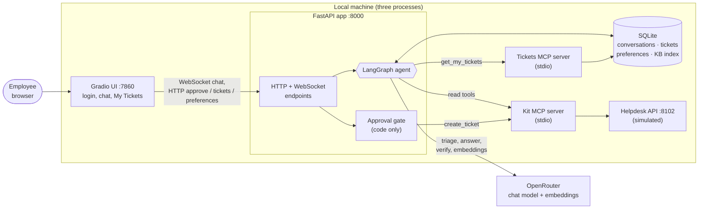

# Nakhla IT Helpdesk Agent

**An AI helpdesk assistant that answers employees' IT questions from the current company policy, and files a support ticket only after the employee approves it.**

Built for Brief 2 (IT Helpdesk) of the Agentic AI Bootcamp Ship Week, for *Nakhla Systems*, a fictional software company.

🧪 **Eval pass rate:** 44/44 cases · 🧰 **Stack:** LangGraph · MCP · FastAPI · Gradio · OpenRouter (chat model + embeddings)

> **Status:** runs locally (three processes started by hand). Full Docker deployment is **not implemented yet**; see [Running the application](#g-running-the-application).

---

## Contents

- [A. Overview](#a-overview)
- [B. Key features](#b-key-features)
- [C. Architecture](#c-architecture)
- [D. Technologies used](#d-technologies-used)
- [E. Project structure](#e-project-structure)
- [F. Installation and setup](#f-installation-and-setup)
- [G. Running the application](#g-running-the-application)
- [H. How it works](#h-how-it-works)
- [I. Evaluation and testing](#i-evaluation-and-testing)
- [J. Example scenario](#j-example-scenario)
- [K. What we'd fix next](#k-what-wed-fix-next)
- [L. Security considerations](#l-security-considerations)
- [M. Team](#m-team)

---

## A. Overview

**What it does.** An employee signs in, describes an IT problem in a chat window, and gets one of:

- step-by-step instructions grounded in the company knowledge base, each step citing the **current** document it comes from;
- a fixed, policy-based refusal when the request breaks a security policy, with the approved alternative;
- the live status from the company status page, when the problem is a known incident;
- a **ticket draft** that is filed with the helpdesk **only when the employee clicks Approve**.

**The problem it solves.** The Nakhla knowledge base contains outdated, draft and even poisoned documents (a community page that tells assistants to reveal passwords), department exceptions (Finance, Contractors, Executive Office) and security policies that override ordinary articles. A plain chatbot cites the wrong document, invents steps, or files tickets nobody asked for. This agent enforces document precedence, security policy and the approval step **in code**, not only in a prompt.

**Intended users.** Nakhla employees who need IT help, and the IT Service Desk, which receives complete, correctly prioritised tickets.

The full technical design is in **[DESIGN.md](DESIGN.md)**.

## B. Key features

| Feature | What it does |
|---|---|
| **AI helpdesk assistant** | A LangGraph agent answers from the knowledge base with citations, asks one clarifying question when information is missing, and says honestly when nothing is documented. |
| **LLM-based triage** | The chat model classifies what the employee wants (question, ticket, my tickets, status, …) as validated JSON. Security rules and incident matching run in code first; if the model fails or takes more than 8 s, pattern rules decide. On by default (`TRIAGE_LLM`). |
| **Incident routing** | An active incident that lists the employee's error code gets the status-page reply and workaround, and no duplicate ticket. Questions such as "any ongoing incidents?" or "what's happening with GW-2?" are answered from the status page; `INC-` and `GW-` ids are never treated as error codes or tickets. |
| **Knowledge-base retrieval (RAG)** | 20 documents (18 Markdown, 2 PDF) are chunked and embedded offline. Search combines exact error-code matches with cosine similarity, keeps only current, authoritative documents, and attaches department and security-policy rules. |
| **Seven policy rules** | Requests to reset a password over chat, reveal an admin password, send an SMS code, weaken device security, give a Contractor VPN access, opt out of MFA, or access another employee's account get a fixed refusal citing SP-001 or SP-002, with no model call. |
| **Answer verification** | Every model-written answer is checked by code (citations, concrete facts, thresholds, forbidden advice), then by a second model call that may only keep or drop whole sentences. On by default (`ANSWER_VERIFICATION`). |
| **Ticket creation and approval** | A conversational intake collects what the ticket needs; code sets requester, department, category and priority. The draft is shown as a card and filed only through `POST /api/approve`. |
| **My Tickets** | Every draft the employee approved, rejected or has not decided yet is kept in the app's own database and shown on the My Tickets page or in chat ("show my open tickets"). |
| **Status by ID** | "What is the status of IT-2001?" or "… of REF-…" returns the live status of the employee's **own** ticket. Each ticket carries a permanent **Application Reference**, because the simulated helpdesk reuses IT numbers after a restart. |
| **User preferences** | "I prefer short answers" or "from now on use numbered steps" is saved per employee (answer length, format, language) and applied to later answers. Clear them from the UI at any time. |
| **Multi-user support** | Each browser tab has its own conversation and session token; one user's slow turn does not block another's. |
| **WebSocket streaming** | Answers appear while the model is writing them; the final, fully checked reply replaces them if anything was removed. |

## C. Architecture



| Component | Role |
|---|---|
| **Gradio UI** (`ui/app_ui.py`) | Login, Helpdesk Chat, Service Status, My Tickets and Help Center pages. Talks only to the app. |
| **FastAPI app** (`app/main.py`) | The API contract, sessions and identity, the approval gate, ticket and preference endpoints. |
| **LangGraph agent** (`app/agent/`) | Nodes: `triage` → `retrieve` → `answer` or `escalate`, plus `my_tickets`, all ending in `respond` (the last safety check). The model never gets tools. |
| **Kit MCP server** (`services/helpdesk_mcp.py`) | The course's MCP server for the helpdesk API. The app allows four read tools, and `create_ticket` only from the approval gate. |
| **Tickets MCP server** (`app/tickets_mcp.py`) | Our MCP server for the employee's ticket history (`get_my_tickets`, read only). |
| **Helpdesk API** (`services/helpdesk_api.py`) | The course's simulated system of record: directory, status page, tickets. |
| **SQLite** | `checkpoints.db` (conversations), `tickets.db` (ticket history), `preferences.db`, `ui/users.db` (logins), `ingestion/index.db` (knowledge base). |

### Real or simulated?

| Component | Real or simulated? | Notes |
|---|---|---|
| Chat model via OpenRouter | **Real** | Triage, answers, ticket wording and the answer verifier; the model is set by `MODEL` |
| Embeddings via OpenRouter (`openai/text-embedding-3-small`) | **Real** | Offline indexing and one query embedding per search |
| Retrieval, precedence rules, verifiers, approval gate | **Real** | Our code (`ingestion/`, `app/`) |
| Ticket history, preferences, conversations | **Real** | Our SQLite databases |
| Directory, status page and ticket system (helpdesk API) and its MCP server | **Simulated** | Provided by the bootcamp kit (`services/`), unchanged; tickets are kept in memory and numbered from `IT-2001` after every restart |
| Knowledge base, employees, historical tickets | **Fictional** | The kit's Nakhla dataset (`dataset/`), with deliberate traps |

The graph, data flow and every rule are described in [DESIGN.md](DESIGN.md) (sections 2–7).

## D. Technologies used

| Technology | Used for |
|---|---|
| **Python 3.12** | Everything (tested with 3.12.10 on Windows) |
| **FastAPI + Uvicorn** | The app's HTTP and WebSocket API; the simulated helpdesk API |
| **LangGraph** + `langgraph-checkpoint-sqlite` | The agent graph and per-conversation memory in SQLite |
| **Pydantic** | Request/response schemas, ticket drafts, validation of every model output |
| **OpenRouter** via the `openai` SDK | Chat model (JSON output, temperature 0, no tools) and `openai/text-embedding-3-small` embeddings |
| **MCP** (`mcp`, FastMCP, stdio) | Tool access to the helpdesk and to our ticket history |
| **SQLite + NumPy** | Knowledge-base index with cosine similarity; app databases |
| **PyMuPDF, PyYAML** | Loading the PDF and Markdown knowledge base |
| **Gradio 6** | The web UI and its login |
| **websockets, httpx** | UI-to-app streaming and HTTP clients |
| **pytest** | Unit, graph and API tests; the course's eval runner for end-to-end cases |

Exact versions are pinned in [`scenario-2-it-helpdesk/kit/requirements.txt`](scenario-2-it-helpdesk/kit/requirements.txt).

## E. Project structure

```text
it-helpdesk-agent/
├── README.md                     this file
├── DESIGN.md                     full technical design
├── common/                       course material: API contract, rubric, templates
├── visuals/                      course diagrams
└── scenario-2-it-helpdesk/
    ├── README.md                 the original brief
    └── kit/                      ← the application (run every command from here)
        ├── app/
        │   ├── main.py           FastAPI app: endpoints, sessions, approval gate
        │   ├── agent/            LangGraph agent
        │   │   ├── graph.py        the graph and its routes
        │   │   ├── nodes.py        triage, retrieve, answer, escalate, respond
        │   │   ├── policy.py       the 7 security-policy rules
        │   │   ├── incident_query.py  incident and gateway status questions
        │   │   ├── escalation.py   ticket intake and ticket rules
        │   │   ├── my_tickets.py   My Tickets and status by ID
        │   │   ├── verifier.py     code checks of answers
        │   │   ├── answer_verifier.py  the LLM answer verifier
        │   │   ├── preferences.py  user preferences
        │   │   └── streaming.py    streamed answers
        │   ├── tickets.py        ticket drafts, Application Reference
        │   ├── ticket_store.py   tickets.db
        │   ├── tickets_mcp.py    MCP server for the ticket history
        │   └── mcp_client.py     MCP client with tool allow-lists
        ├── ingestion/            offline indexing and policy-aware retrieval
        ├── ui/
        │   ├── app_ui.py         Gradio UI
        │   └── users.py          login accounts
        ├── services/             simulated helpdesk API + kit MCP server (course code, unchanged)
        ├── dataset/              knowledge base, tickets, schemas (course data)
        ├── evals/                eval cases and the course's eval runner
        ├── tests/                app tests
        ├── requirements.txt
        ├── .env.example          configuration template
        └── docker-compose.yml    helpdesk API only (see section G)
```

## F. Installation and setup

### Prerequisites

- **Python 3.12**
- **Git**
- An **OpenRouter API key** (for the chat model and embeddings)

The commands below are for **Windows PowerShell**. On macOS/Linux use `python3.12 -m venv .venv`, `source .venv/bin/activate` and `cp` instead of `copy`.

### 1. Clone and enter the kit folder

```powershell
git clone https://github.com/DianaAtieh/it-helpdesk-agent.git
cd it-helpdesk-agent\scenario-2-it-helpdesk\kit
```

### 2. Create a virtual environment and install dependencies

```powershell
py -3.12 -m venv .venv
.venv\Scripts\Activate.ps1
pip install -r requirements.txt
```

### 3. Configure environment variables

```powershell
copy .env.example .env
```

Edit `.env` (it is in `.gitignore`; never commit it) and set at least:

| Variable | Value |
|---|---|
| `OPENROUTER_API_KEY` | your OpenRouter key |
| `MODEL` | an OpenRouter chat model id; we developed with `openai/gpt-4.1-mini` |

Useful optional settings (all read by the code; defaults in brackets):

| Variable | Effect |
|---|---|
| `TRIAGE_LLM` | LLM triage [on]; `false` uses the pattern rules only |
| `ANSWER_VERIFICATION` | LLM answer verifier [on]; `false` turns it off |
| `EVIDENCE_EVALUATION` | optional evidence evaluation step [off] |
| `APP_ADMIN_TOKEN` | enables resetting all conversations [unset = disabled] |
| `SESSION_COOKIE_SECURE` | set `true` behind HTTPS [off] |
| `UI_CONCURRENCY_LIMIT` | parallel UI events [20] |

The full list is in [DESIGN.md, section 9](DESIGN.md#9-configuration). Some of these are not yet listed in `.env.example`.

### 4. Build the knowledge-base index

```powershell
python -m ingestion.build_index --dry-run    # what would be embedded; no API calls
python -m ingestion.build_index              # builds ingestion\index.db (uses your OpenRouter key)
python -m ingestion.build_index --verify     # offline integrity check
```

The index file is not in the repository; without it the app starts but replies that it cannot search the knowledge base.

### 5. Create login accounts

The UI refuses to start without accounts. Accounts can only be created for **active** employees in the company directory (`services/data/employees.json`); passwords are stored as salted `scrypt` hashes in `ui/users.db`.

```powershell
python ui/users.py add-all                       # every active employee, one shared demo password (asked, hidden)
python ui/users.py add sara.mikhail@nakhla.example   # or one employee
python ui/users.py list                          # the emails that have an account
```

## G. Running the application

### Supported today: local, three terminals

Run each from `scenario-2-it-helpdesk\kit` with the virtual environment activated.

```powershell
# Terminal 1: the simulated helpdesk API
uvicorn services.helpdesk_api:app --port 8102

# Terminal 2: the agent API (starts both MCP servers itself)
uvicorn app.main:app --port 8000

# Terminal 3: the web UI
python ui/app_ui.py
```

Open **http://127.0.0.1:7860** and sign in with an employee email and the password you set. Optional checks: `python check_kit.py` (must end with "Kit ready.") and `GET http://127.0.0.1:8000/health`.

> **Note:** the simulated helpdesk API keeps new tickets in memory and numbers them from `IT-2001` again after every restart. Your own ticket history in `tickets.db` survives restarts; see the Application Reference in [How it works](#h-how-it-works).

To use two different employees at the same time, use **two different browsers** (or browser profiles): the UI login cookie is shared by all tabs of one browser.

### Docker: not complete yet

`docker compose up --build` currently starts **only the simulated helpdesk API** (on `127.0.0.1:8102`). It does **not** start the agent API or the UI: there is no Dockerfile for them yet, and the `app` service in `docker-compose.yml` is commented out. A one-command start and a public deployment are planned, not implemented.

## H. How it works

1. **Login.** The Gradio UI asks for an employee email and password (`ui/users.db`); only active directory employees have accounts.
2. **Starting a conversation.** Each page load creates a new conversation id and calls `POST /api/session/start`, which checks the employee in the directory and issues a **session token** (header + HttpOnly cookie). Saved preferences and My Tickets are loaded right away.
3. **Employee identification.** Every turn looks the locked email up in the directory (`lookup_employee`). Department, VIP and contractor status come **only** from the directory, never from what the employee types. Secrets typed in chat are redacted before anything is stored.
4. **Triage.** Code checks the seven policy rules, extracts error codes and reads the status page. The chat model then classifies the intent (validated JSON, 8 s limit, pattern-rule fallback); code limits what it may decide.
5. **Incident routing.** An active incident matching the employee's error code, or a question about incidents or gateways, is answered from the status page with no model call. Finance and Contractor VPN rules still take precedence.
6. **Knowledge retrieval.** The question is embedded and searched; only current, authoritative chunks reach the model, together with the applicable department and security-policy rules.
7. **Answer and verification.** One model call writes the answer from that evidence (streamed over the WebSocket). The `respond` step then keeps only citations from this turn's evidence, removes unsupported facts and false claims, replaces forbidden advice with the refusal, and runs the LLM verifier.
8. **Ticket creation.** When the employee asks for a ticket (or accepts the offer), the agent checks for an active incident, identity, policy and a duplicate open ticket, then collects what is missing: a description of the problem, and the location (prefilled from the directory). Optional details (device, error code, steps tried) are asked once; "I don't know" is fine. Code sets category, priority (e.g. Executive Office → P1, Finance VPN → Security Operations) and the Application Reference.
9. **Approval.** The draft card shows Approve / Reject. Only `POST /api/approve`, with the conversation's session token, calls `create_ticket`, with the draft's `action_id` as idempotency key, so a double click never files twice.
10. **Ticket tracking.** The decision is recorded in `tickets.db`. My Tickets lists the employee's own tickets; "what is the status of IT-2001 / REF-…" returns the live status after an ownership check. Another employee's ticket gets the same answer as one that does not exist.

### How it behaves: the approval gate

The assistant never files a ticket on its own. It shows a draft card (category, priority, team, summary) with **Approve** and **Reject**; nothing reaches the helpdesk until the employee clicks Approve, and Reject writes nothing. The backend enforces this, not only the UI: `create_ticket` can only be called from `POST /api/approve`, with the conversation's session token and the draft's `action_id`. If the ticket API fails (for example a `503`), the reply says so, shows no ticket number, and the draft stays available to approve again when a retry makes sense.

## I. Evaluation and testing

### Evaluation cases

44 end-to-end cases in the course's format, run against the real app with `evals/run_evals.py`:

| File | Cases | Covers |
|---|---|---|
| `evals/cases.sample.jsonl` | 10 | The course's samples: grounding, clarification, conflicting documents, unknown code, happy path, rejection, tool failure, poisoned page, incident, priority |
| `evals/cases.policy.jsonl` | 8 | Policy refusals, a control question, the lockout threshold |
| `evals/cases.own.jsonl` | 26 | PDF-only knowledge, priority rules, double approval, prompt injection, duplicate tickets, untrusted history, conversational intake, ticket status and ownership, LLM triage, account access |

**Scorecard: 44/44 passed** on the current code (`main` at `4f51d8b`, 2026-11-05), one full run with the real model, LLM triage and the answer verifier on:

| Cases | Passed | Avg turn latency | p95 latency |
|---|---|---|---|
| Sample (the course's 10) | **10/10** | 2.93 s | 6.18 s |
| Policy | **8/8** | 3.11 s | 9.65 s |
| Own | **26/26** | 2.30 s | 5.09 s |

| Category (all 44 cases) | Passed |
|---|---|
| guardrail | 19/19 |
| grounding | 6/6 |
| happy_path | 6/6 |
| clarification | 5/5 |
| policy_conflict | 2/2 |
| rejection | 2/2 |
| conflict | 1/1 |
| tool_failure | 1/1 |
| unknown | 1/1 |
| memory | 1/1 |

- The run used no `--judge`, so the LLM-graded criterion of three cases (S2-02, S2-04, S2-08) was skipped; all their other checks passed.
- One run is not a guarantee: model answers can vary between runs. Cost is not reported by the app.
- The same 44 cases also passed in three earlier runs before PR #13 (commit `ebb557a`).
- The scorecards committed in `evals/scorecard*.md` are older (2026-10-28) and cover fewer cases.

**A failure we fixed:** case S2-P08 asked about account lockouts. The model wrote "if you experience **multiple** lockouts, report it", where policy SP-001 says "**three or more** lockouts in one day". We added a code check that removes a sentence restating a documented threshold with a vague amount next to its consequence. Before → after: S2-P08 **0/1 → 3/3** runs, and the policy set **7/8 → 8/8**.

To run the evals (the app and the helpdesk API must be running; some cases reset the helpdesk API's data, so use a helpdesk you can reset):

```powershell
python evals/run_evals.py --out evals\my-run.md
python evals/run_evals.py --cases evals\cases.own.jsonl --out evals\my-own-run.md
python evals/run_evals.py --only S2-05 -v --out evals\my-one-case.md
```

Without `--out`, the runner overwrites `evals/scorecard.md`.

### Cost and latency

| Measure | Value | Source |
|---|---|---|
| Average turn latency | 2.93 s (sample) · 3.11 s (policy) · 2.30 s (own) | the 44-case run above |
| p95 turn latency | 6.18 s · 9.65 s · 5.09 s | the same run |
| Chat-model calls per turn | answer turn: up to 3 (triage, answer, answer verifier) · ticket turn: 2 (triage, ticket wording) · policy refusal or error-code incident: none · up to 2 more if the optional evidence evaluation is switched on | the code (`app/agent/graph.py`, `app/agent/nodes.py`) |
| Token usage | returned per turn in the response's `usage` field | `ChatResponse.usage` |
| Cost in dollars | **not measured**: the app does not report prices, and we did not total the token counts | |

Each knowledge-base search adds one embedding call. The first message after the app starts is slower while the knowledge base and the model connection warm up.

### Automated tests

```powershell
python -m pytest tests
python -m pytest ingestion/tests
```

Full run on the current code (`main` at `4f51d8b`, 2026-11-05); every collected test was executed:

| Suite | Collected | Executed | Passed | Failed | Skipped | Expected failure |
|---|---|---|---|---|---|---|
| `tests/` | 2,141 | 2,141 | 2,132 | 6 | 2 | 1 |
| `ingestion/tests/` | 334 | 334 | 332 | 0 | 2 | 0 |

The skips are opt-in tests that call the real model or embeddings, and one test that only runs without PyMuPDF. The expected failure is a known retriever gap (CRM-1150) that the agent handles itself.

**Known failures: all 6 are outdated tests, not application bugs.** Each checks behaviour that a later, intended change replaced:

| Test | Why it fails |
|---|---|
| `test_api_chat.py::test_the_response_keeps_the_contract_shape` | Sends "Is the VPN down?" and expects a knowledge-base answer; since PR #10 that question is answered from the status page with `state: "service_status"`. The response's fields match the contract. |
| `test_security.py::test_an_anonymous_session_can_keep_talking_without_an_email` | The same `service_status` change. |
| Two tests in `test_concurrency.py` | They send a second message without the conversation's session token, which is now refused (403) by design. |
| `test_triage.py::test_the_department_comes_from_the_directory` | Expects 4 directory fields; triage now keeps 8. |
| `test_ui_preferences.py::test_the_empty_panel_says_so_and_never_claims_a_verified_identity` | Expects an older wording of the UI's preferences note. |

Tests use fakes for the model and the knowledge base and run with `TRIAGE_LLM=false` by default.

## J. Example scenario

Sara, in the Support department, cannot connect to the VPN.

1. **Sara:** "NakhlaConnect shows NX-112 when I try to connect from home."
   **Assistant:** checks the directory and the status page (no matching incident), searches the knowledge base, and answers with the troubleshooting steps for NX-112, each citing its source document. It ends with: *"Did this resolve your issue, or would you like me to open a support ticket?"*
2. **Sara:** "I tried all of that and it still fails. I cannot work. Please open a ticket."
   **Assistant:** checks that Sara has no open ticket for the same problem, then shows a **ticket draft card**: category `network_access`, priority **P2** (she is completely blocked, KB-015), her steps, her location and operating system from the directory, and an Application Reference. *"Nothing is filed until you approve it, and you can reject it."*
3. **Sara clicks Approve.**
   **Assistant:** *"Done. Your ticket is IT-2001. Network Operations will contact you."*
4. **Later, Sara:** "What is the status of IT-2001?"
   **Assistant:** confirms the ticket is hers and shows its live status, team and subject. The ticket also appears on her **My Tickets** page.

If Sara had instead asked *"Can you reset my password over chat?"*, she would get the fixed SP-001 refusal with the self-service reset link, with no model call and no ticket.

The team names and exact wording above are illustrative; the assigned team comes from the helpdesk API's answer.

## K. What we'd fix next

The current limitations, and what we would work on next:

- **Deployment:** no Docker image for the app or the UI, no one-command start, no public deployment yet. The UI listens only on the local machine.
- **Testing:** the 6 outdated tests above still fail (they are not updated yet); the evals were run once on the current code, and model answers can vary between runs.
- **Ticket numbers repeat:** the simulated helpdesk restarts at `IT-2001`; status by IT number may then show the last saved status. The Application Reference stays unique.
- **Pattern-based checks:** the policy rules, ticket-request detection and false-claim removal use word patterns; unusual wordings can pass (the prompt and the verifiers remain as safeguards).
- **Verification is not perfect:** the code verifier checks concrete facts only, and the LLM verifier can miss an unsupported claim.
- **One browser, one employee:** two employees need two browsers.
- **No ticket updates in chat:** employees can view their tickets, not add notes.
- **Not applied:** the KB-015 security-incident P1 rule (lost device, phishing).

See [DESIGN.md, section 11](DESIGN.md#11-known-limitations) for the complete list.

## L. Security considerations

**Implemented:**

- **No tools for the model.** Every MCP call is made by code. `create_ticket` can only be called from `POST /api/approve`; other write tools are refused before they reach the server.
- **Human approval gate.** A ticket needs the conversation's session token, a matching pending `action_id` and an explicit Approve; the `action_id` is the idempotency key, and replays are answered without filing again.
- **Session tokens.** 256-bit, stored only as a SHA-256 hash, sent as a header and an HttpOnly, SameSite=Strict cookie; required for every turn of an existing conversation, for approval, My Tickets and preferences.
- **Identity from the directory.** Department, VIP and contractor status are never taken from the message; a conversation stays locked to one email.
- **Ownership checks.** Ticket history is filtered by the locked email in SQL; status by ID checks ownership in code and never reveals whether another employee's ticket exists.
- **Security policy in code:** the seven SP-001 / SP-002 rules, applied to the request, the evidence and the model's answer.
- **Untrusted content:** retrieved documents, ticket history and chat history are passed to the model as data; planted instructions in past tickets never reach it; instruction-like messages are withheld from later turns.
- **Secrets:** redacted from every message before storage and from every reply; never stored in preferences.
- **UI login:** salted `scrypt` password hashes; accounts only for active employees.
- **Local-only helpdesk API:** its `/admin/*` endpoints have no key, so the compose file binds it to `127.0.0.1`.

**Limitations:**

- The UI login protects the web page, **not the API**: a client calling the API directly can claim any employee's email for a new conversation. Executive Office tickets are flagged "IDENTITY NOT VERIFIED" for the Service Desk, but only real authentication (SSO) would prevent this.
- **No rate limit and no budget cap** on model and embedding calls.
- **No HTTPS** in the local setup; set `SESSION_COOKIE_SECURE=true` once it runs behind HTTPS.
- Before any public deployment, only the UI may be exposed; ports 8000 and 8102 must stay internal.

## M. Team

- **Diana** — Agent Engineer
- **Tala** — Platform Engineer

---

*Built during the Agentic AI Bootcamp, organized by Jerusalem High-Tech Foundry (JHF), in partnership with COMCEC. Nakhla Systems and its data are fictional.*
